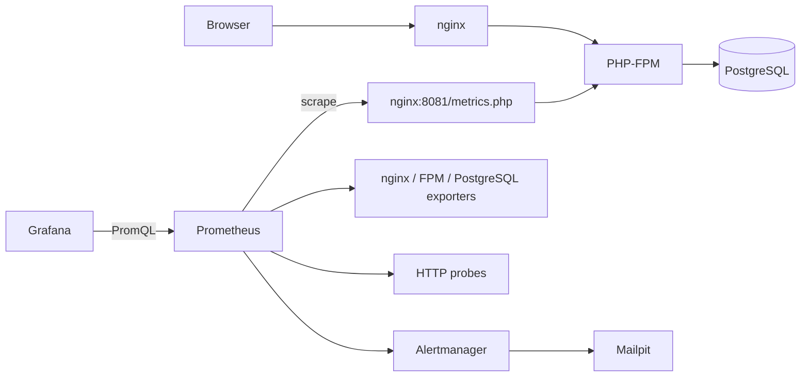

# Sortix / trello-web

Учебное PHP-приложение, развиваемое в сторону Trello-подобного менеджера задач.
**Текущий HTTP-сценарий — создание и просмотр заметок.** Модели и миграции пользователей,
досок, колонок и карточек уже есть; `app/resources/templates` содержит отдельный
прототип интерфейса. Регистрация, авторизация, роли, командные пространства и полноценный
API досок пока не реализованы.

Стек: PHP 8.5, PostgreSQL 18, Eloquent 12, Monolog 3, Docker Compose. HTTP-логика
сейчас находится в `app/public/index.php`, а не в отдельных контроллерах и сервисах.
Есть классы конфигурации и AES-256-GCM для зашифрованных настроек.

## Мониторинг

Prometheus собирает метрики приложения, nginx, PHP-FPM и PostgreSQL. Blackbox exporter
проверяет HTTP и `SELECT 1`. Grafana автоматически загружает четыре дашборда: обзор
сервиса, запись заметок, nginx, PostgreSQL. Alertmanager отправляет учебные письма
в локальный Mailpit.

**Пробел:** при ошибке INSERT приложение возвращает 302, а SELECT 1 проходит.
Зелёные health, up, pg_up и отсутствие 5xx не доказывают, что заметки сохраняются.
Добавлены счётчик исходов записи, гистограмма длительности, четыре панели и NoteWriteErrors.

- [Каталог всех групп метрик, PromQL и проверка](docs/METRICS.md).
- [Отдельное описание изменений метрик: было / стало](docs/METRICS_CHANGES.md).
- [Инструкции реагирования](docs/runbooks).

## Запуск с мониторингом

Нужны Docker и Compose 2.24.4+ (`!reset` убирает порт CLI-сервера при переходе на FPM).
Команды для PowerShell; в bash первая команда — `cp .env.example .env`.
Не перезаписывайте существующий `.env`.

```powershell
Copy-Item .env.example .env # только если файла ещё нет
docker compose -f compose.yaml -f compose.monitoring.yaml build
docker compose -f compose.yaml -f compose.monitoring.yaml run --rm --no-deps app composer install
docker compose -f compose.yaml -f compose.monitoring.yaml up -d
docker compose -f compose.yaml -f compose.monitoring.yaml exec app php bin/migrate up
docker compose -f compose.yaml -f compose.monitoring.yaml exec app php bin/seed-demo
docker compose -f compose.yaml -f compose.monitoring.yaml exec db sh /docker-entrypoint-initdb.d/02-monitoring.sh
```

`seed-demo` создаёт отсутствующего демопользователя и печатает `DEMO_USER_ID`.
Если ID отличается от 1, задайте его в `.env` и повторите `up -d`.
Это локальный учебный режим, не авторизация. Скрипт PostgreSQL идемпотентен:
на существующем томе его запускают отдельно, без удаления данных.

| Сервис | Адрес по умолчанию |
|---|---|
| Приложение / health | http://127.0.0.1:8090/ / http://127.0.0.1:8090/health.php |
| Grafana | http://127.0.0.1:13000/ |
| Запись заметок | http://127.0.0.1:13000/d/note-writes |
| Prometheus | http://127.0.0.1:19090/ |
| Alertmanager | http://127.0.0.1:19093/ |
| Mailpit | http://127.0.0.1:18025/ |

Просмотр Grafana без входа, редактирование — admin/admin для локального стенда.
Пароли и порты задаются в `.env`. Если 5432 занят, поменяйте `DB_HOST_PORT`.
Все опубликованные порты привязаны к 127.0.0.1. Метрики доступны на внутреннем
nginx:8081/metrics.php, пользовательский порт возвращает для них 404.



Метрики приложения хранятся в общей памяти APCu одного FPM-пула. Рестарт FPM сбрасывает
счётчики; rate/increase обрабатывают сбросы. Prometheus хранит историю в отдельном томе
до 7 дней или 1 ГБ. Несколько экземпляров приложения следует опрашивать отдельно.

## Проверка

```powershell
docker compose -f compose.yaml -f compose.monitoring.yaml exec prometheus promtool check config /etc/prometheus/prometheus.yml
docker compose -f compose.yaml -f compose.monitoring.yaml exec prometheus promtool test rules /etc/prometheus/tests/note-writes.yml
docker compose -f compose.yaml -f compose.monitoring.yaml exec alertmanager amtool check-config /etc/alertmanager/alertmanager.yml
docker compose -f compose.yaml -f compose.monitoring.yaml exec app php tests/monitoring.php --allow-fault-injection
```

Интеграционный тест проверяет успех, HTTP 422, скрытую ошибку INSERT при HTTP 302,
зелёный health, гистограмму и восстановление. Временный триггер отклоняет только
уникальный тестовый заголовок; записи, триггер и функция убираются в finally.
Запускайте на учебном стенде без параллельных POST, так как проверяются точные
приращения общих счётчиков. Promtool проверяет длительные ошибки, простой,
одиночную ошибку и сброс счётчика.

## Базовый режим и структура

Без overlay сохраняется CLI HTTP-сервер и метрики выключены:
`docker compose build`, `docker compose run --rm --no-deps app composer install`,
`docker compose up -d`, затем `php bin/migrate up` и `php bin/seed-demo` через exec app.
Для перехода с мониторинга сначала выполните
`docker compose -f compose.yaml -f compose.monitoring.yaml down` **без -v**, чтобы nginx
освободил APP_PORT. Для мониторингового режима используйте оба compose-файла.

| Путь | Назначение |
|---|---|
| app/public | Страница заметок, router, health и metrics |
| app/src/Models | User, Note, Board, BoardColumn, Card |
| app/database/migrations | Реальная схема БД |
| app/src/Http/RequestLog.php | HTTP-журнал, сейчас включает тело ответа |
| app/src/Metrics.php | Бизнес-метрики |
| app/instrumentation/prepend.php | HTTP-счётчик и гистограмма |
| docker | Контейнеры, экспортеры, правила, дашборды |

Реальные таблицы: users, notes, boards, board_columns, cards и migrations.
projects, project_members и activity_logs пока отсутствуют. Часть полей моделей
досок и карточек ещё не добавлена в миграции.

Runner создаёт users раньше исторически более ранней notes, сохраняя имена миграций.
Страница использует реальные поля note_id/created_datetime и обязательного владельца
DEMO_USER_ID. Счётчик созданий не равен текущему числу строк после удалений.

`make help` показывает команды. Для мониторинга также доступны `make mon-up`,
`make mon-check`, `make mon-reload`, `make pg-monitoring`, `make seed-demo`.
`make clean` удаляет данные; обычная остановка — down без -v.

cAdvisor вынесен в отдельный `compose.cadvisor.yaml` и автоматически не запускается:
ему нужны привилегии и cgroups. Добавьте этот файл, профиль cadvisor и scrape job
из `docker/prometheus/cadvisor.yml`, если нужны контейнерные CPU/RAM/network.
На Docker Desktop видимость метрик может отличаться. Graylog/OpenSearch — отдельный
стек логов, поэтому в этот перенос метрик не включён.
